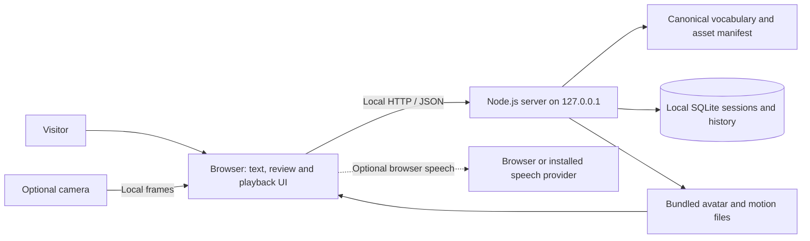
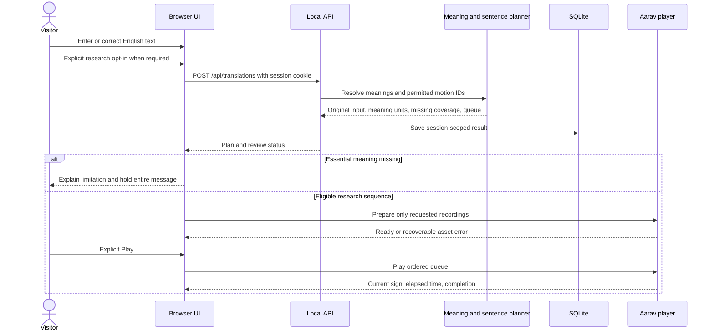
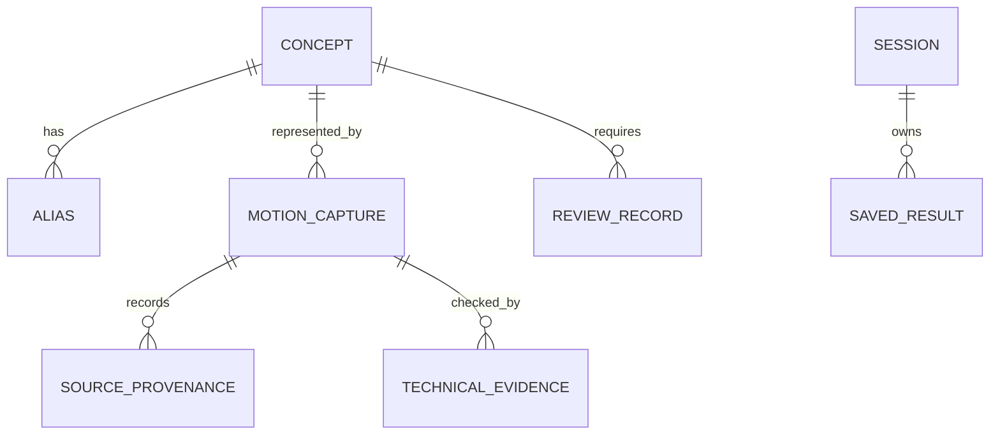
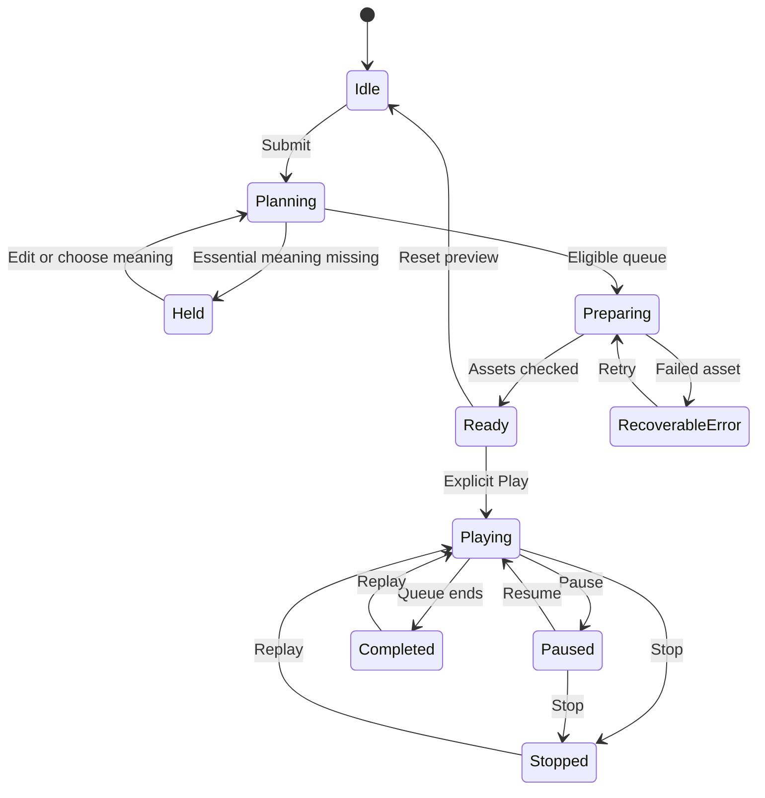

# Technical Design Document

## 1. Document information

Product: **Sign Studio** · Team: **Beyond Words** · Theme: **Digital inclusion**

Developers: **Anushk Singh, Himanshu Pandey, Akshar Ratna**.

Prepared: **27 October 2026**. Describes the current local prototype, rather than a proposed production system. This document addresses the technical-document requirement supplied for the submission; it does not assert certification against an unseen competition rubric.

## 2. Problem and supported scope

Written/spoken English alone does not address every communication need. The prototype provides an inspectable path from English input to visible ASL motion research previews. It helps a visitor understand which meanings have recordings and where coverage is absent.

The implemented product is a vocabulary planner and animation player. It is not an English-to-fluent-ASL model, a qualified interpreter, an ISL translator or a continuous ASL recognizer. No linguistic approval is inferred from a successfully loaded file.

## 3. System context

Camera frames are not uploaded to the Node server. Optional browser transcription and remote speech voices can involve provider services; text-only playback does not require a paid API or account.

## 4. Components and responsibilities

| Component | Files | Responsibility |
| --- | --- | --- |
| HTTP application | `server.mjs` | Static files, JSON routes, sessions, validation and localhost binding |
| Meaning resolution | `backend/interpret.mjs` | Unicode tokenization, protected names, corrections, aliases and sense choices |
| Vocabulary service | `backend/catalog.mjs` | Mode/consent gates, matching, response assembly and coverage |
| Sentence planning | `backend/sentence-plan.mjs` | Whole-message meaning units, cautious normalization and blocked/approximate plans |
| Sentence ideas | `backend/sentence-examples.mjs` | Finite candidate ideas checked against available motion plans |
| Capability evidence | `backend/readiness.mjs` | Current file hashes, rig evidence, eligible counts and definitions |
| Persistence | `backend/store.mjs` | SQLite sessions, preferences and saved translation/inspection payloads |
| UI controller | `web/app.js` | Input/review flow, queues, cancellation, library/history and state-aware controls |
| Avatar renderer | `web/avatar.js` | Three.js human model, retargeted playback, preflight framing and cleanup |
| Motion loader | `web/asl-loader.js` | Bounded motion downloads, pinned hashes, track validation and retargeting |
| Registry | `web/vocabulary.mjs`, `web/sign-registry.mjs` | Manifest-derived concept/animation lookup and validation gates |
| Media controls | `web/voice.js`, `web/camera-policy.mjs`, `web/camera-detector.mjs` | Browser speech, pose inference, stability and confirmation |

The current runtime uses JavaScript ES modules, Node.js 22.13+, SQLite, Three.js 0.170.0 and MediaPipe Tasks Vision 0.10.14. No React build or Python training server is required for this Studio.

## 5. Processing and playback sequence

Phrase mappings are considered before shorter word matches. Normalization handles selected contractions/inflections only where the existing planner supports them. Original text, punctuation and source positions remain available. The planner does not invent ASL syntax by rearranging English tokens. Ambiguous meanings can require a user choice; unreviewed synonyms do not automatically enter playback.

## 6. Data model and evidence

The first five entities are logical structures stored in manifests/audits, not SQL tables. SQLite implements `sessions` and `translations`; a saved result is stored as a JSON payload. Sessions retain language/speed preferences; history is capped at 200 items per session by the store.

A concept has a stable ID and word sense. Aliases/inflections point to concepts; animations have separate stable IDs, motion paths, durations, file/content hashes and provenance. Multiple legitimate captures can represent one concept. Technical evidence and linguistic review are separate records. Source catalogue entries without imported files are not counted as playable assets.

The retained snapshot has 728 compatible concepts, 729 captures, 726 opt-in text captures across 725 concepts, and zero linguistically approved signs. Counts are derived through `studioReadiness()`; current file and rig hashes must match audit evidence. Refer to `SIGN_DATA_VALIDATION.md` for linguistic review requirements and `THIRD_PARTY_NOTICES.md` for asset-specific permissions.

## 7. Modes and state

- Validated mode is the default; currently no approved clips qualify.
- Expanded research text playback requires a true explicit consent flag and an eligible source mapping. It is not approval.
- Asset inspection can show unverified recordings independently of text availability.
- Procedural/pose demonstrations are illustrative and distinct from recorded ASL research clips.

The diagram summarizes user-visible transitions, not every internal enum value. New requests cancel/supersede older work. Stop retains a queue for replay; Reset Preview clears playback while preserving typed input. Failed assets offer retry without substituting unrelated motion.

## 8. HTTP interface

| Method | Route | Purpose |
| --- | --- | --- |
| GET | `/api/health` | Health/storage/version |
| GET | `/api/catalog` | Public catalogue and readiness; cached gzip supported |
| POST | `/api/session` | Create/resume a session and set cookie |
| GET / PATCH | `/api/session` | Read/update language and supported speed |
| POST | `/api/translations` | Resolve/process input and save result |
| GET / DELETE | `/api/history` | List/clear this session's history |
| GET | `/api/history/export` | Download session history JSON |

Stateful routes require the session cookie. The cookie uses HttpOnly and SameSite=Strict; local HTTP is not presented as secure internet authentication. JSON bodies are bounded to 1 MiB. Input limits are 100,000 characters and 10,000 words, with explicit rejection rather than truncation. Speed preferences accept 0.6, 1 and 1.5. Server-side request limits, static path restrictions and timeout handling exist; they do not make this a production security architecture.

## 9. Rendering and performance

The loader downloads requested motion clips rather than the complete animation library on initial page load. A small technically checked demo set may be primed. The prepared-motion cache is bounded for unrelated inspections, but active/saved long queues are retained and may exceed the nominal 40-clip cache target.

The player preflights source poses, unions signing-space bounds and frames face/hands/fingertips before playback. Wide or low movements can require a wider view than a strict waist crop. Camera reset, resize and fullscreen recompute framing without changing motion bindings. Render resources, stream tracks, timers, listeners and audio are cleaned up on relevant lifecycle transitions. Test evidence establishes sampled technical compatibility, not human ASL correctness or guaranteed mobile frame rates.

## 10. Camera and speech boundaries

The camera model recognizes seven general hand poses. Five illustrative mappings produce four response labels: Open_Palm→Hello, Thumb_Up→Yes, Thumb_Down→No, Victory→Hello, ILoveYou→Love. Optional Closed_Fist and Pointing_Up act as player controls. These are not seven recognized ASL words. Policy uses confidence/stability checks, neutral release/cooldowns and confirmation to reduce accidental repeats. Two-hand temporal ASL recognition is not implemented.

Speech uses available browser voices. Microphone transcription remains editable, is explicitly started, and can fail due to permissions/provider support. Sign Studio does not store microphone audio. Browser/provider processing is separate from the local camera pipeline.

## 11. Deployment, testing and limitations

The supported deployment is a local Node process plus browser at `127.0.0.1`. `SIGN_PORT` is the only application environment variable read by `server.mjs`; no automatic dotenv loader exists. SQLite is created in `data/`. No production cloud deployment, external recognition endpoint or paid speech configuration is implemented.

See `docs/TEST_CASES.md` for reproducible fixtures and manual steps. The 20 October regression covered all 112 selected checks after six sandbox-blocked API checks passed in a permitted rerun; its all-library renderer simulation passed. That is historical evidence, not a new 27 October full-suite run. Current submission fixture results are recorded separately.

Remaining work includes fluent-signer review, validated nonmanual grammar and sentence assets, fingerspelling assets, continuous sign recognition, physical media tests and production-grade authentication/deployment. These are future plans, not features claimed by this submission.
